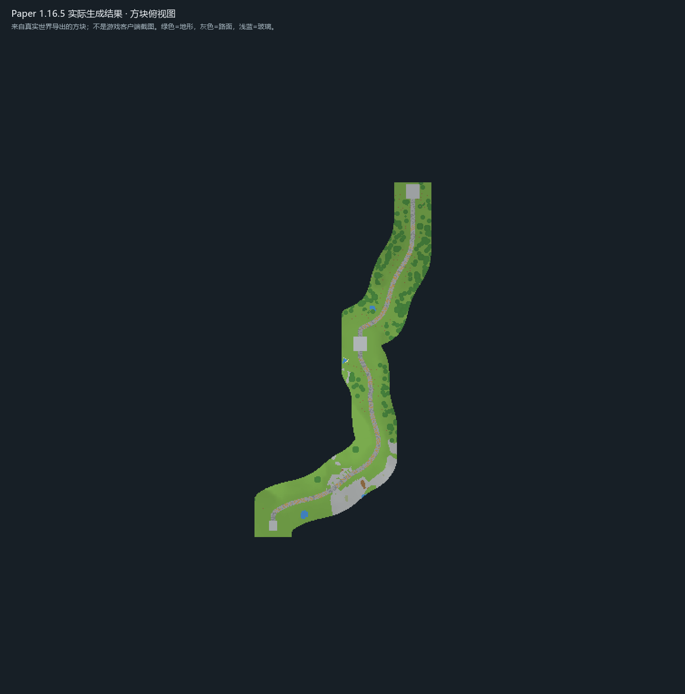
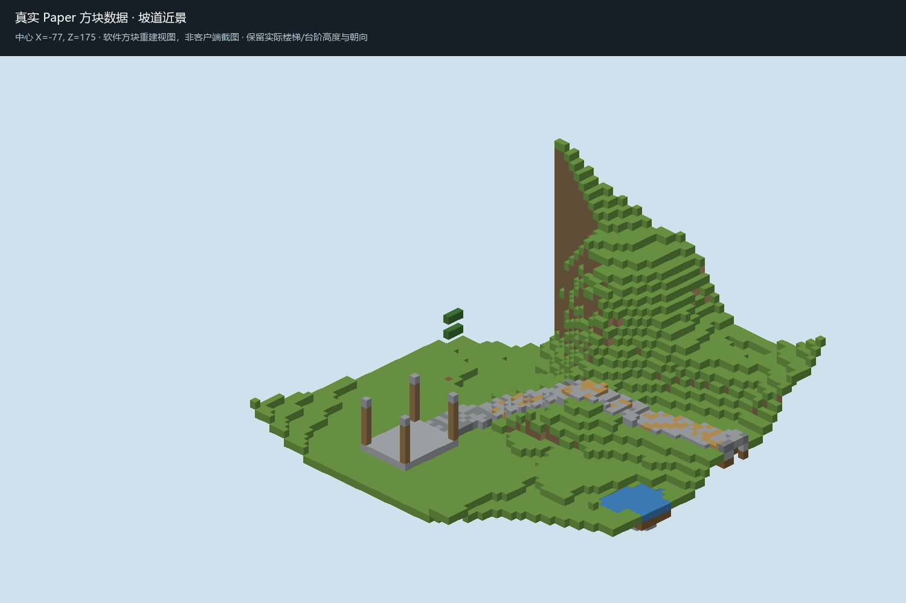
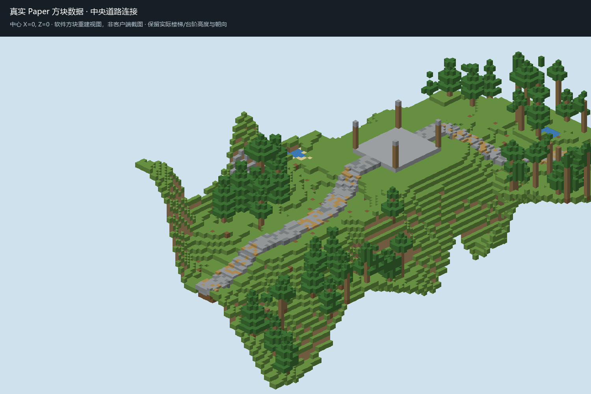

# MapReset 2.3.0 · 真实 Paper 地图生成测试

测试日期：2026-10-24（Asia/Shanghai）。目标是修正截图中的杂乱楼梯、道路宽度突变、入口折转与地形衔接。

## 本次修复

道路采用统一的连续高程与稳定 5 格名义路宽，不再让相互重叠的路面片段各自决定高度。斜坡使用半格台阶和较高行的楼梯衔接；入口与中段共同平滑。寻路禁止沿起终点方向倒退，避免在建筑前绕出回头弯。路肩采用最近道路断面，而不是叠加各段最低高度；近路断面优先于建筑周边修整。保留水面抬高、双侧开顶玻璃护栏和整树清理逻辑。

## 安装

替换旧 MapReset JAR 后完整启动服务器，保留现有配置、模型和大厅初始化。新版生成版本会使旧备用地图移入 retired 并补库；当前游戏地图保持原样，在新备用地图完成后通过 `mapreset reset` 换入。不要使用热重载。请先在副本验证。本包只更新地图插件。

## 真实测试证据

- 服务端：官方 Paper 1.16.5 build 794，仅监听本机回环地址；没有连接正式服。
- 下载：仅补 Paper JAR，53,944,842 字节，已按官方 SHA-256 校验；原版服务端、Java、Maven 编译依赖、Python/Pillow 复用本地已有文件。
- 原版世界 seed=12345，完整生成/扫描 44×44=1936 区块，范围700×700；原地面 Y=30..123，水域列 28,996。
- 对真实世界快照迭代修复；最终版本再次运行生产规划、清树、修整、铺路、建筑、自查和备用保存，已生成 READY 地图。
- 最终实际路面方块：2142；两条道路中间及左右各一条通行线，共 9756 个服务器 NMS 碰撞形状采样点。
- 无可站立碰撞面的采样点：0；相邻采样点高度跳变超过0.6格：0；最大跳变：0.5格；道路纵向回头段：0。
- 原生产生成自查 validation.passed=true，碰撞采样统计见 [collision-report.json](实测结果/collision-report.json)。最终选路避开了水边的旧绕行段，本次最终图的玻璃护栏列数为0；迭代中较早路线实测生成过46列双侧护栏，最终代码的护栏规则未改，另有对应单元测试。
- 41项单元/API/真实地形回归测试通过。真实地形压缩数据随源码测试资源提供，可以复现本次发现的建筑前回头弯。
- 测试使用的 MapReset JAR 与交付 JAR 的 SHA-256 一致：`5d87f63eb7b29912680c0ae907aa1c147c1839f6280aa785821c071ab5006ece`。

## 测试发现的限制

这次包含真实服务端生成与实际碰撞形状采样，未进行真实客户端自动行走、跳跃、多人战斗或长期负载测试。三条通行线是点采样，不代表所有可能路径和完整玩家碰撞箱的穷举。图像是实际方块导出的软件重建图，不是游戏截图；区域边缘有裁切，地下结构未完整绘制。

清树阶段记录到一次约5.7秒的 Can't keep up 落后警告，因此不能宣称整个生成过程完全不卡。此前也有一次测试工具未缓冲读取快照导致的停顿，该工具问题已修正。原版区块的生成节奏和配置速率本轮未调整；性能问题与道路形状修复分开记录，尚未进行针对性优化。日志同时包含保存世界的常规提示。

地图自然观感仍需要在客户端查看；方块网格中的斜线边缘会有正常锯齿。建议重点查看 a、b、c 入口、斜向坡道和临水路段。测试服已正常停止，未部署到正式服。

## 结果图

详细配置、接口与升级说明见[README.md](README.md)；复现测试见[测试工具说明](测试工具/README.md)。
